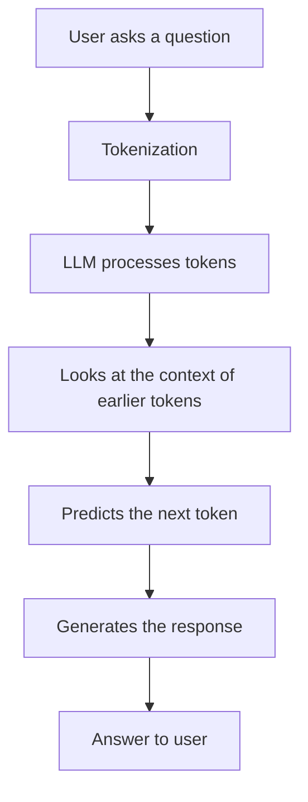

# How LLMs Work

## Diagram

## My understanding
An LLM (Large Language Model) is an AI model trained on a lot of text. By reading that text, it learns how words and sentences usually go together.

When I ask a question, the LLM first splits my text into small pieces called tokens. Each token is turned into a number so the model can work with it. The model then looks at all the tokens so far and predicts the next token. It adds that token to the answer and repeats until the answer is finished.

Example: if I ask "What is phishing?", the model predicts an explanation one token at a time, and the tokens together make the answer.

## What I understood
- An LLM works with tokens, not whole sentences at once.
- It predicts one next token at a time, using the tokens before it.
- It can write answers, summaries and explanations.
- It can be wrong, because it predicts likely text and does not check facts. So answers must be checked with trusted sources.

## Connection with CyberSuraksha
In CyberSuraksha, an LLM can explain cyber fraud in simple language. For a question about a phishing link, it can explain how the scam works, the warning signs and the precautions.

The chatbot should use our stored fraud records, so the answer comes from reliable data. If the answer is not in our records, for example a question about a law section or one person's bank refund, it should say so clearly instead of guessing.